## Hi, I'm Vladimir 👋

I'm **Vladimir Kostelei**, known online as **ismd**. Software/Platform engineer somewhere on the Internet. Yandex was the biggest chapter of my career: eight years as a tech lead on Yandex Cloud and Yandex News.

**I build software and the platforms behind it.**

### Building Now

- 📚 [linktheca](https://github.com/ismd/linktheca) — Self-hosted read-it-later that also watches the web: describe a topic in plain language, get matching articles. Go, Postgres + pgvector, React + TypeScript, local embeddings

### Side Projects

- 🗂️ [preview-tab.el](https://github.com/ismd/preview-tab.el) — VS Code's preview tab, for Emacs. On [MELPA](https://melpa.org/#/preview-tab)
- 🏴 [blackarch-docker](https://github.com/ismd/blackarch-docker) — The BlackArch pentest toolkit in a container: a terminal, or a full desktop in the browser. 9k+ pulls on [Docker Hub](https://hub.docker.com/r/ismd/blackarch)
- 🎨 [hugo-theme-vng-blue](https://github.com/ismd/hugo-theme-vng-blue) — Hugo blog theme with a perfect Lighthouse score, tag filtering and 30+ social icons. Listed in [Hugo Themes](https://themes.gohugo.io/themes/hugo-theme-vng-blue/)
- ✍️ [Coding Overhead](https://coding-overhead.com) — My blog about programming, Linux and DevOps, in English and Russian
- 🐧 [dotfiles](https://github.com/ismd/dotfiles) — Arch Linux + Hyprland, managed with chezmoi
- 📸 [screenshotgun](https://github.com/ismd/screenshotgun) — Cross-platform screenshot tool with cloud upload, C++/Qt. Retired after a good run

### Latest Posts

<!-- posts:start -->
- [Adding DNS Records on Keenetic Routers](https://coding-overhead.com/posts/keenetic-dns-records/) · 2026-10-20
- [\[RU\] SSH — безопасный доступ к удалённым серверам](https://coding-overhead.com/posts/ssh/) · 2026-03-13
- [\[RU\] WebAuthn и Passkeys — аутентификация без паролей](https://coding-overhead.com/posts/webauthn-passkeys/) · 2026-02-18
- [\[RU\] MFA — многофакторная аутентификация](https://coding-overhead.com/posts/mfa/) · 2026-02-17
- [\[RU\] nohup — процессы, которые не умирают](https://coding-overhead.com/posts/nohup/) · 2025-12-16
<!-- posts:end -->

### Find Me

[ismd.dev](https://ismd.dev) · [LinkedIn](https://linkedin.com/in/ismdev) · [Blog](https://coding-overhead.com) · [github@ismd.dev](mailto:github@ismd.dev)
